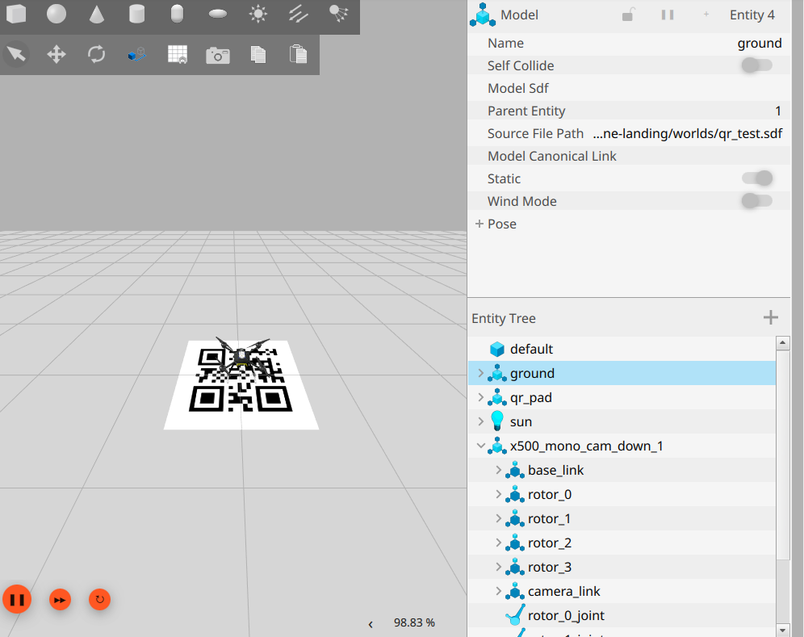

# Gazebo Camera Drone and QR Landing

A camera-equipped drone simulation built with Gazebo Harmonic and PX4 SITL on Ubuntu. The project streams images from a downward-facing camera through Gazebo Transport and detects the `LANDING_PAD_01` QR code with OpenCV. An optional MAVSDK mission adds target search, alignment, and autonomous landing.

The core assignment is to add a camera-equipped drone to Gazebo and capture its camera feed. QR detection and the landing mission extend that task.



[Watch the camera and QR detection demo](docs/media/camera-demo.mp4)

## Environment

- Ubuntu 24.04.3 LTS and Python 3.12
- Gazebo Harmonic / Gazebo Sim 8.10.0
- PX4 SITL with the `x500_mono_cam_down` model
- OpenCV, Gazebo Transport 13 / Messages 10, and MAVSDK
- Direct Gazebo image subscription; no ROS bridge required

PX4 source code, build artifacts, and drone models are not bundled in this repository. The project uses an existing PX4 installation. ArduPilot is not required.

## Prerequisites

Confirm that `gz sim --version` works. Your PX4 checkout must contain the `x500_mono_cam_down` model and a built `build/px4_sitl_default/bin/px4` executable. The project scripts do not install Gazebo or build PX4.

Install the Ubuntu dependencies:

```bash
sudo apt update
sudo apt install python3-venv python3-pip python3-opencv python3-gz-transport13 python3-gz-msgs10
```

The Gazebo Python packages require the APT repository used for your Gazebo installation to be configured.

## Setup

After cloning the repository or extracting the project archive, run this from the project root:

```bash
bash scripts/setup.sh
```

The virtual environment uses the system OpenCV and Gazebo Python packages. NumPy is pinned to 1.26.4 for compatibility with Ubuntu's OpenCV package.

By default, the project looks for PX4 at `~/PX4-Autopilot`. To use another location, set this in the simulation terminal:

```bash
export PX4_DIR=/absolute/path/to/PX4-Autopilot
```

## Run the simulation and camera

Open each terminal in the project root. These examples use PX4 instance **1**. Keep the instance consistent across commands.

### Terminal 1: Gazebo server and PX4

```bash
bash scripts/start.sh --instance 1
```

Wait for the startup success message and leave this terminal running. The supervisor waits up to 120 seconds for PX4 initialization. Diagnostic output is written to `logs/`.

### Terminal 2: Live camera and QR detection

```bash
QR_SITL_INSTANCE=1 bash scripts/image.sh
```

The camera points downward. While the drone is on the ground, the view may show only the ground with a `NO QR` message. The drone itself does not need to appear in its own camera feed.

### Terminal 3: Gazebo scene

```bash
GZ_PARTITION=qr_landing_project GZ_IP=127.0.0.1 gz sim -g --render-engine-gui ogre
```

Double-click `x500_mono_cam_down_1` in the Entity Tree to focus on the drone. Its `camera_link` entry identifies the camera link. Capture the scene and the live camera window together to demonstrate both the model and its image feed.

### Check the MAVSDK connection

Run this in a separate terminal:

```bash
QR_SITL_PORT=14541 .venv/bin/python src/telemetry.py
```

`connected: true` confirms the connection. `is_armable: true` reports the current readiness to arm.

## Optional QR landing mission

The following command moves the simulated drone:

```bash
QR_SITL_INSTANCE=1 bash scripts/flight.sh
```

The mission includes takeoff to 3 meters, bounded search, motion-direction verification, alignment over the QR target, descent, and LAND. The horizontal speed limit is 0.25 m/s and the descent speed is 0.15 m/s. The controller requires fresh frames and stable detection before descending.

Height is estimated from the local NED position relative to the preflight reference, assuming flat ground. No lidar measurement is used.

To cancel, press **Ctrl+C in the flight terminal**, or run:

```bash
bash scripts/cancel.sh
```

Keep the simulation running until landing and motor disarming are confirmed. Then press Ctrl+C in the simulation terminal or run:

```bash
bash scripts/stop.sh
```

If communication is completely lost, the application cannot guarantee delivery of the LAND command.

## Rendering and troubleshooting

On the demonstrated computer, Ogre2 / EGL failed with OpenGL errors and a segmentation fault. Switching to `ogre` allowed the user to capture the live camera and Gazebo scene. The server therefore defaults to `ogre`.

Forcing `LIBGL_ALWAYS_SOFTWARE=1` also crashed inside the graphics driver on this computer and is not part of the default launch command.

On another computer with working Ogre2 support, select it with:

```bash
QR_RENDER_ENGINE=ogre2 bash scripts/start.sh --instance 1
```

Renderer compatibility depends on the computer and graphics driver.

Inspect startup logs with:

```bash
tail -n 50 logs/gazebo.log
tail -n 40 logs/px4.log
```

A `gz_frame_id` warning alone does not establish a startup failure. Stop project-owned processes through the provided scripts instead of using broad `pkill` commands.

## Repository structure

| Path | Purpose |
| --- | --- |
| `src/camera.py` | Camera subscription, QR detection, and image preview |
| `src/telemetry.py` | MAVSDK connection and health checks |
| `src/flight.py` | QR-guided flight and landing mission |
| `src/measure.py` | Final position-error measurement using Gazebo ground truth |
| `scripts/` | Setup, launch, cancellation, and diagnostic scripts |
| `models/qr_pad/` | QR pad model, mesh, and texture |
| `worlds/` | Simulation and diagnostic worlds |
| `docs/media/` | Captured Gazebo screenshot and camera recording |
| `VALIDATION.md` | Report from earlier local tests |
| `docs/TECHNICAL_NOTES.md` | Detailed notes from the initial version |

## Validation status

The supplied screenshot and video demonstrate the drone model in Gazebo, a live camera feed, and QR detection. An earlier local test report records a final horizontal landing error of **1.89 cm**. This result is specific to that test and is not guaranteed for subsequent runs.

Python, shell, and XML syntax checks passed while preparing this repository. The Gazebo flight was not rerun in the repository preparation environment.

`VALIDATION.md`, `TROUBLESHOOTING.md`, and `docs/TECHNICAL_NOTES.md` preserve the original Turkish test notes. Their `/home/bahar` paths, headless-rendering commands, and log references describe earlier local sessions. Use this README for the current launch procedure. Runtime logs, PID records, virtual environments, and PX4 build artifacts are excluded from Git.

This project is intended for simulation and has not been validated on a physical drone.
